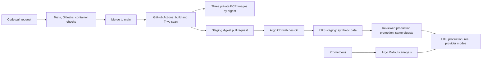

# Market Intel: Stock Market Delivery Platform

Three Python microservices demonstrate a complete container release path: GitHub Actions CI, private Amazon ECR images, Argo CD GitOps on Amazon EKS, and monitored progressive delivery. Application source and deployment configuration live in [Saisharath123/market_intel](https://github.com/Saisharath123/market_intel).

**Implementation status:** the revised delivery platform is being prepared locally. No AWS deployment or GitHub push for this revision has been performed. Historical October deployment records do not establish current availability. Sonar integration is an optional later step until its server and credentials are configured.

The stock dashboard uses actual Yahoo Finance quotes and CNBC TV18 RSS headlines in production mode. It polls and caches responses for five minutes; it does **not** provide exchange tick streaming. Staging uses explicit synthetic fixtures so release verification does not depend on an external feed. Live adapters never silently substitute demo prices.

## What is in this repository

| Component | Responsibility |
|---|---|
| Dashboard (`services/dashboard`) | Streamlit UI, consuming both internal APIs over HTTP |
| Market API (`services/market`) | Six-symbol watchlist, quote normalization, changes and insights |
| News API (`services/news`) | Bounded, deduplicated RSS headlines and source timestamps |
| CI (`.github/workflows`) | Tests, container smoke checks, secret scanning, image scanning and optional Sonar quality gate |
| GitOps (`deploy/chart`, `deploy/argocd`) | Staging and production configuration, immutable image digests and rollout policy |
| Monitoring (`deploy/monitoring`) | Versioned Prometheus/Grafana bootstrap values and application dashboard |
| Infrastructure (`infra`) | EKS configuration and bootstrap tooling; provisioning is a separate operator action |

See [architecture and boundaries](docs/ARCHITECTURE.md), [release walkthrough](docs/CICD.md), [operations and recovery](docs/OPERATIONS.md), and [costs and teardown](docs/COSTS.md). Start monitoring with [its versioned bootstrap instructions](deploy/monitoring/README.md).

## Delivery flow



Workflow files describe intended checks. A configured Sonar token, a green Actions run, a successful image push, and a healthy Kubernetes rollout are separate evidence; committing their configuration does not establish any of those results. See the release guide for the precise enablement requirements and evidence commands.

## Run locally

Docker Desktop must be running with Linux containers:

```powershell
$env:MARKET_MODE = 'demo'
$env:NEWS_MODE = 'demo'
docker compose up --build --wait
```

Open [the dashboard](http://localhost:8501), [market API docs](http://localhost:8000/docs), and [news API docs](http://localhost:8001/docs). Stop local containers with `docker compose down`. To use the external feeds, set `MARKET_MODE=yahoo` and `NEWS_MODE=cnbctv18`, then recreate the containers. No credentials are required for these two adapters.

For Python-only development:

```powershell
python -m venv .venv
.venv\Scripts\python -m pip install -r requirements-dev.txt
$env:MARKET_MODE = 'demo'
$env:NEWS_MODE = 'demo'
.venv\Scripts\python -m streamlit run app.py
```

Without `MARKET_API_URL` and `NEWS_API_URL`, the dashboard uses standalone mode. EKS and Compose set these URLs so requests reach the separate APIs.

## Data and API contract

| Endpoint | Meaning |
|---|---|
| `GET /health` | Process liveness, independent of upstream availability |
| `GET /api/v1/quotes` | Market mode/source, status, fetch time, quotes and missing symbols |
| `GET /api/v1/insights` | Watchlist breadth and sorted changes; implemented by the market API |
| `GET /api/v1/news` | News mode/source, status, fetch time and up to 30 headlines |
| `GET /metrics` | API HTTP counters and latency histograms for Prometheus |

Data endpoints may return HTTP 200 with `status=partial`, `unavailable`, `stale` or `unknown`. Inspect the payload and source timestamps. A green process-health check does not prove that market data is complete, fresh, or licensed for redistribution.

The quote cache is per process; production replicas do not share it. There is no durable price history, database, trading execution or distributed cache. Yahoo access uses the unofficial yfinance client and can be delayed or rate-limited. Public/commercial redistribution requires appropriate provider rights. The UI checks for updates every 30 seconds while open, but each backend cache refreshes at most once per five minutes. Its age warning is not an exchange trading calendar.

## Validation

```powershell
.venv\Scripts\python -m ruff check .
.venv\Scripts\python -m pytest -q
```

Tests use demo/mocked inputs and verify quote math, timestamps, missing symbols, outages without synthetic fallback, RSS parsing and API/UI behavior. CI also exercises the three containers together. Current test results are in GitHub Actions; historical deployment notes elsewhere in the repository are dated snapshots, not current availability claims.

The original Streamlit Community Cloud deployment is an independent delivery path. This EKS project does not require changing or deleting it. Older EC2/Client VPN/internal DNS helpers are retained history and are not prerequisites for the current EKS path; do not execute them as part of this bootstrap.
