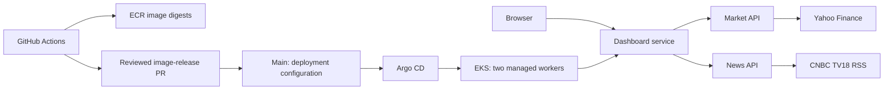
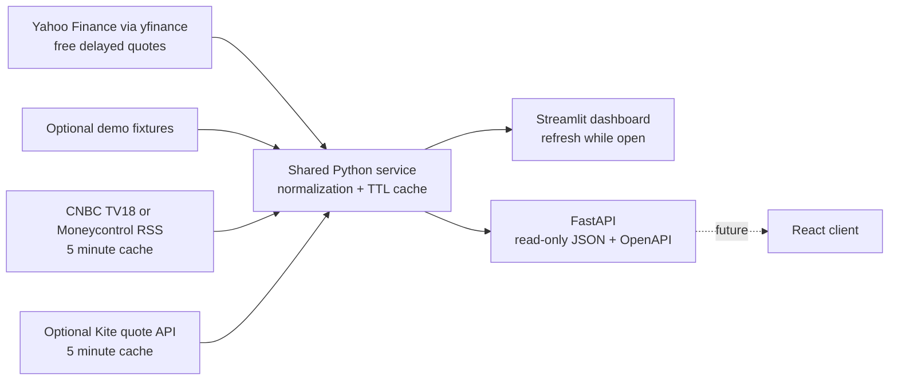
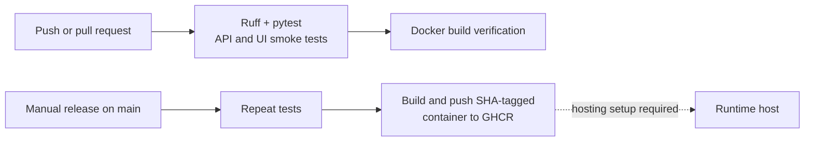

# India Market Pulse

Python / Streamlit MVP with a read-only FastAPI interface. Starts with **actual Indian market prices from Yahoo Finance** and CNBC TV18 RSS news. No API key or paid subscription is required. Prices may be delayed or from an older trading session. Set both `MARKET_MODE=demo` and `NEWS_MODE=demo` for a fully offline preview. Live adapters never fall back silently to demo values.

## Online dashboard and automatic deployment

Dashboard: [India Market Pulse](https://market-intel-saisharath123.streamlit.app/).

Streamlit Community Cloud is connected to `Saisharath123/market_intel`, branch `main`, entry file `app.py`, using Python 3.11. Commits pushed to `main` are automatically picked up by Streamlit. Python changes update the running app; dependency changes trigger dependency installation. No deploy token or manual GitHub Actions release is needed for this dashboard.

GitHub Actions still runs lint, tests and the Docker build independently. Streamlit's automatic deployment does not wait for those checks; review changes on a branch and merge after CI passes. The manual GHCR container workflow remains an alternative delivery path and is not used by Community Cloud.

The online deployment serves the Streamlit dashboard only; the optional FastAPI server is not deployed. Defaults are Yahoo Finance prices and CNBC TV18 RSS. Change future credentials in Community Cloud's app settings, not in the repository. Community Cloud may put inactive apps to sleep.

## Run on Windows

Open this folder in VS Code, then run these commands in its terminal:

```powershell
python -m venv .venv
.venv\Scripts\python -m pip install -r requirements-dev.txt
Copy-Item .env.example .env
.venv\Scripts\python -m streamlit run app.py
```

Dashboard: http://localhost:8501. In a second terminal, optionally run the API:

```powershell
.venv\Scripts\python -m uvicorn market.api:app --host 127.0.0.1 --port 8000
```

Interactive API docs: http://localhost:8000/docs. Streamlit calls the shared service directly, so it runs without the API process. A future React client can use the same API.

## Data sources and refresh

| Source | Configuration | Behavior |
|---|---|---|
| Yahoo Finance | `MARKET_MODE=yahoo` (default) | Keyless actual prices for six NSE symbols; five-minute cache; may be delayed |
| Demo | `MARKET_MODE=demo`, `NEWS_MODE=demo` | Six fixed synthetic quotes and one example headline; never current prices |
| CNBC TV18 RSS | `NEWS_MODE=cnbctv18` (default) | Market headlines, source links and publication times; five-minute cache |
| Moneycontrol RSS | `NEWS_MODE=moneycontrol` | Headlines, source links and publication times; five-minute cache |
| Zerodha Kite | `MARKET_MODE=kite`, `KITE_API_KEY`, `KITE_ACCESS_TOKEN` | Official quote endpoint; five-minute cache |

Put secrets only in local `.env` or the deployment platform's environment settings. Restart after changes. Never commit `.env`. Kite requires a valid market-data entitlement and authenticated access token; token generation is outside this MVP. The token expires at 6 AM the next day according to the provider documentation. No credentials are required for demo mode or RSS.

The UI checks for updates every 30 seconds while open; the shared quote cache refreshes at most once every five minutes per process. This is polling, not tick-by-tick streaming. Yahoo quote timestamps are displayed in Indian time, with quote age and session date in the details table. Quotes older than 36 hours trigger a warning, which may also occur over holidays/weekends; the warning does not infer an exchange trading calendar. Fetch timestamps are UTC and are not exchange timestamps. News may be older than its fetch time. Missing quotes and upstream failures are shown explicitly. There is no durable history or stale-data fallback. Caches are per process, so the separate API and dashboard maintain independent caches.

Yahoo is accessed through the unofficial open-source [yfinance client](https://pypi.org/project/yfinance/). The client describes its data access as intended for personal research/educational use. Free access is not a public/commercial redistribution licence; review Yahoo's terms for the intended audience. No availability SLA or exact delay is guaranteed, and cloud IPs may be rate-limited. Failures leave quotes unavailable, never synthetic. Each symbol is fetched independently with a bounded timeout, with up to three requests in parallel. Prices and timestamps come from quote metadata; changes compare with the last unadjusted daily close before the quote's trading date, not the chart-range baseline. Verified locally on 21 October 2026: all six quotes returned, with latest source timestamps of 19 October 2026; the UI flags their age.

CNBC TV18 feed: https://www.cnbctv18.com/commonfeeds/v1/cne/rss/market.xml. Verified on 21 October 2026: 200 RSS items with same-day publication timestamps; the app keeps the first 30 usable items. Moneycontrol feed: https://www.moneycontrol.com/rss/marketreports.xml; verification returned April 2024 headlines, so it is not the default. A feed whose newest headline is over 72 hours old is flagged `stale`; absent/unverifiable or future dates produce `unknown` freshness. Only RSS titles/links/timestamps are read; full articles and paywalls are not scraped. Feed reachability is environment-dependent and does not establish redistribution permission. Confirm source terms before public/commercial publishing. Screener, Tickertape, Trendlyne and other page scrapers are not implemented. Fundamental data is a separate future adapter.

## APIs implemented

| Method and path | Response |
|---|---|
| `GET /health` | Process liveness, not upstream health |
| `GET /api/v1/quotes` | Mode, provider, status, fetch time, quotes and missing symbols |
| `GET /api/v1/news` | Mode, provider, status, fetch time and up to 30 headlines |
| `GET /api/v1/insights` | Quote status, watchlist advances/declines and sorted stock changes |
| `GET /docs` | Interactive OpenAPI documentation |

Data endpoints return HTTP 200 with an explicit `status` (`ok`, `partial`, `unavailable`, `stale`, `unknown`); clients must inspect it. Insight breadth covers four watchlist stocks only. Indices are excluded. The API is intended for local use: authentication, distributed rate limits and public hosting are not configured.

## Architecture

### EKS microservices migration

The EKS path splits the app into independently built dashboard, market API and news API containers. Run all three locally with `docker compose up --build`; EKS uses internal HTTP services, while the existing Streamlit-hosted site keeps standalone mode. Kubernetes resources, an Argo CD project/application, an ECR image-release workflow and a two-node eksctl cluster configuration are prepared. These files do not provision AWS automatically. See [the EKS runbook](infra/EKS-RUNBOOK.md) for exact status, permissions, bootstrap, release, rollback and remaining production requirements.





## CI and delivery

For a low-cost AWS learning exercise, optional [CodeBuild checks](.github/workflows/aws-ci.yml) are prepared with [buildspec.yml](buildspec.yml). They are manual-only and disabled unless the `AWS_CI_ENABLED` repository variable is `true`. The [AWS setup guide](infra/aws-ci-setup.txt) describes the project, restricted IAM/OIDC permissions, account variables, cost calculation, and cleanup. No AWS resources have been provisioned. The dashboard stays on Streamlit, so this option adds no always-on AWS hosting cost. These AWS checks are independent of Streamlit's deployment trigger.



`.github/workflows/ci.yml` runs on pushes, pull requests and manual dispatch. Tests use demo data without network or credentials. `.github/workflows/release.yml` is manually triggered on `main`, repeats tests and publishes an immutable commit-tagged image to GitHub Container Registry using `GITHUB_TOKEN`. A branch named differently requires adjusting that guard. Repository/organization package policy may require enabling package publishing.

The workflows are included in [Saisharath123/market_intel](https://github.com/Saisharath123/market_intel). Pushes trigger the test-and-build workflow; view execution status in the repository's Actions tab. Container publication is delivery, not deployment. The dashboard is hosted separately on Streamlit Community Cloud as described above. GitHub Actions does not run the dashboard or poll live prices. Scheduled Actions are not used because their execution can be delayed.

To run a built image: `docker run --env-file .env -p 8501:8501 india-market-pulse`. For API hosting, override the image command with `uvicorn market.api:app --host 0.0.0.0 --port 8000` and map port 8000 instead. Keep secrets in runtime configuration, never in the image build.

## Validation

```powershell
.venv\Scripts\python -m ruff check .
.venv\Scripts\python -m pytest -q
```

Tests cover price-change math against the correct prior session, timestamp validation, missing/invalid Yahoo quotes, partial and total outages without synthetic fallback, RSS deduplication and unsafe links, API responses and a Streamlit demo smoke test. CI uses mocked or demo data and does not depend on Yahoo availability.

Provider and framework documentation:
- https://kite.trade/docs/connect/v3/market-quotes/
- https://kite.trade/docs/connect/v3/user/
- https://docs.streamlit.io/develop/api-reference/execution-flow/st.fragment
- https://docs.github.com/en/actions/how-tos/troubleshoot-workflows

Next decisions: licensed live-data provider, fundamentals provider, and whether public data redistribution is allowed by the selected subscriptions.
