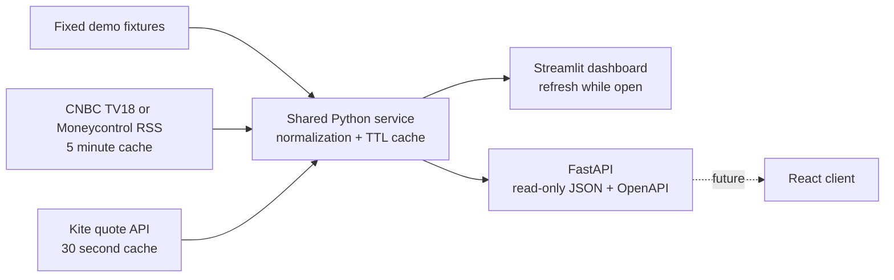
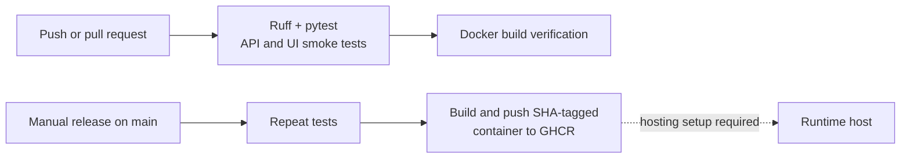

# India Market Pulse

Python / Streamlit MVP with a read-only FastAPI interface. Starts with **fixed synthetic quotes** and CNBC TV18 RSS news. Set `NEWS_MODE=demo` for a fully offline preview. Live adapters never fall back silently to demo values.

## Online dashboard and automatic deployment

Dashboard: [India Market Pulse](https://market-intel-saisharath123.streamlit.app/).

Streamlit Community Cloud is connected to `Saisharath123/market_intel`, branch `main`, entry file `app.py`, using Python 3.11. Commits pushed to `main` are automatically picked up by Streamlit. Python changes update the running app; dependency changes trigger dependency installation. No deploy token or manual GitHub Actions release is needed for this dashboard.

GitHub Actions still runs lint, tests and the Docker build independently. Streamlit's automatic deployment does not wait for those checks; review changes on a branch and merge after CI passes. The manual GHCR container workflow remains an alternative delivery path and is not used by Community Cloud.

The online deployment serves the Streamlit dashboard only; the optional FastAPI server is not deployed. Defaults are demo prices and CNBC TV18 RSS. Change future credentials in Community Cloud's app settings, not in the repository. Community Cloud may put inactive apps to sleep.

## Run on Windows

Open this folder in VS Code, then run these commands in its terminal:

```powershell
python -m venv .venv
.venv\Scripts\python -m pip install -r requirements-dev.txt
Copy-Item .env.example .env
.venv\Scripts\python -m streamlit run app.py
```

Dashboard: http://localhost:8501. In a second terminal, optionally run the API:

```powershell
.venv\Scripts\python -m uvicorn market.api:app --host 127.0.0.1 --port 8000
```

Interactive API docs: http://localhost:8000/docs. Streamlit calls the shared service directly, so it runs without the API process. A future React client can use the same API.

## Data sources and refresh

| Source | Configuration | Behavior |
|---|---|---|
| Demo | `MARKET_MODE=demo` (default), `NEWS_MODE=demo` | Six fixed synthetic quotes and one example headline; never current prices |
| CNBC TV18 RSS | `NEWS_MODE=cnbctv18` (default) | Market headlines, source links and publication times; five-minute cache |
| Moneycontrol RSS | `NEWS_MODE=moneycontrol` | Headlines, source links and publication times; five-minute cache |
| Zerodha Kite | `MARKET_MODE=kite`, `KITE_API_KEY`, `KITE_ACCESS_TOKEN` | Official quote endpoint; 30-second cache |

Put secrets only in local `.env` or the deployment platform's environment settings. Restart after changes. Never commit `.env`. Kite requires a valid market-data entitlement and authenticated access token; token generation is outside this MVP. The token expires at 6 AM the next day according to the provider documentation. No credentials are required for demo mode or RSS.

The UI checks for updates every 30 seconds while open. This is polling, not tick-by-tick streaming. Quote timestamps come from Kite when available; fetch timestamps are UTC and are not exchange timestamps. Older quotes remain possible after market close. News may be older than its fetch time. Missing quotes and upstream failures are shown explicitly. There is no durable history or stale-data fallback. Caches are per process, so the separate API and dashboard maintain independent caches.

CNBC TV18 feed: https://www.cnbctv18.com/commonfeeds/v1/cne/rss/market.xml. Verified on 21 October 2026: 200 RSS items with same-day publication timestamps; the app keeps the first 30 usable items. Moneycontrol feed: https://www.moneycontrol.com/rss/marketreports.xml; verification returned April 2024 headlines, so it is not the default. A feed whose newest headline is over 72 hours old is flagged `stale`; absent/unverifiable or future dates produce `unknown` freshness. Only RSS titles/links/timestamps are read; full articles and paywalls are not scraped. Feed reachability is environment-dependent and does not establish redistribution permission. Confirm source terms before public/commercial publishing. Screener, Tickertape, Trendlyne and other page scrapers are not implemented. Fundamental data is a separate future adapter.

## APIs implemented

| Method and path | Response |
|---|---|
| `GET /health` | Process liveness, not upstream health |
| `GET /api/v1/quotes` | Mode, provider, status, fetch time, quotes and missing symbols |
| `GET /api/v1/news` | Mode, provider, status, fetch time and up to 30 headlines |
| `GET /api/v1/insights` | Quote status, watchlist advances/declines and sorted stock changes |
| `GET /docs` | Interactive OpenAPI documentation |

Data endpoints return HTTP 200 with an explicit `status` (`ok`, `partial`, `unavailable`, `stale`, `unknown`); clients must inspect it. Insight breadth covers four watchlist stocks only. Indices are excluded. The API is intended for local use: authentication, distributed rate limits and public hosting are not configured.

## Architecture



## CI and delivery



`.github/workflows/ci.yml` runs on pushes, pull requests and manual dispatch. Tests use demo data without network or credentials. `.github/workflows/release.yml` is manually triggered on `main`, repeats tests and publishes an immutable commit-tagged image to GitHub Container Registry using `GITHUB_TOKEN`. A branch named differently requires adjusting that guard. Repository/organization package policy may require enabling package publishing.

The workflows are included in [Saisharath123/market_intel](https://github.com/Saisharath123/market_intel). Pushes trigger the test-and-build workflow; view execution status in the repository's Actions tab. Container publication is delivery, not deployment. The dashboard is hosted separately on Streamlit Community Cloud as described above. GitHub Actions does not run the dashboard or poll live prices. Scheduled Actions are not used because their execution can be delayed.

To run a built image: `docker run --env-file .env -p 8501:8501 india-market-pulse`. For API hosting, override the image command with `uvicorn market.api:app --host 0.0.0.0 --port 8000` and map port 8000 instead. Keep secrets in runtime configuration, never in the image build.

## Validation

```powershell
.venv\Scripts\python -m ruff check .
.venv\Scripts\python -m pytest -q
```

Tests cover price-change math, missing quotes, RSS deduplication and unsafe links, provider outage behavior, API responses and a Streamlit demo smoke test.

Provider and framework documentation:
- https://kite.trade/docs/connect/v3/market-quotes/
- https://kite.trade/docs/connect/v3/user/
- https://docs.streamlit.io/develop/api-reference/execution-flow/st.fragment
- https://docs.github.com/en/actions/how-tos/troubleshoot-workflows

Next decisions: licensed live-data provider, fundamentals provider, and whether public data redistribution is allowed by the selected subscriptions.
