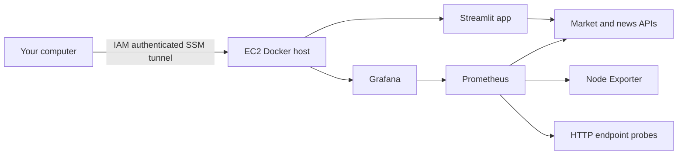

# Market Intel on one EC2 server

Prepared 23 October 2026. This replaces the deleted EKS deployment with one Mumbai t3a.medium server (2 vCPU, 4 GiB RAM), one encrypted 30 GiB gp3 root disk and Docker Compose. It is a learning/internal deployment with a single point of failure, not a highly available production cluster.

## Architecture



## Access and permissions

No inbound security-group rules, SSH keys, NAT gateway, load balancer, EKS or VPN. A public IPv4 address supplies outbound HTTPS access; it does not expose application ports. The instance role has AmazonSSMManagedInstanceCore for authenticated administration. EC2 requires IMDSv2 with hop limit 1. App, Grafana and Prometheus are bound to loopback. Users need IAM-authorized AWS Session Manager port forwarding, AWS CLI and the Session Manager plugin locally. The tunnel encrypts traffic; localhost HTTP is carried within it. No public HTTPS URL is created.

Grafana admin credentials are generated on the server, kept outside Git and bootstrap logs, and mounted as a file secret. Retrieve the initial password only in your own authenticated Session Manager terminal:

```sh
sudo cat /opt/market-intel-secrets/grafana-admin-password
```

Username: admin. Never send this password into chat.

## Launch

Review cloudformation.json and bootstrap.sh before applying. On authenticated AWS CloudShell, use launch.py with the exact reviewed Git commit SHA. This creates stack market-intel-ec2 in ap-south-1 with CAPABILITY_IAM. The bootstrap clones that public repository at the immutable commit, verifies Docker Compose/Buildx release checksums, builds the three app images, pulls pinned monitoring images and installs a systemd service. Follow /var/log/market-intel-bootstrap.log until MARKET_INTEL_BOOTSTRAP_COMPLETE.

## Open the dashboards

Replace INSTANCE_ID with the CloudFormation output. Run each command in a separate local terminal after AWS login, keeping the session open:

```sh
aws ssm start-session --region ap-south-1 --target INSTANCE_ID --document-name AWS-StartPortForwardingSession --parameters 'portNumber=["3000"],localPortNumber=["3000"]'
aws ssm start-session --region ap-south-1 --target INSTANCE_ID --document-name AWS-StartPortForwardingSession --parameters 'portNumber=["8501"],localPortNumber=["8502"]'
aws ssm start-session --region ap-south-1 --target INSTANCE_ID --document-name AWS-StartPortForwardingSession --parameters 'portNumber=["9090"],localPortNumber=["9090"]'
```

Grafana: http://localhost:3000 — folder Market Intel, dashboards Market Intel APIs and Market Intel EC2 Overview.
App: http://localhost:8502. Prometheus: http://localhost:9090 — Targets and Alerts.

## What is monitored

Prometheus scrapes the two API metrics endpoints, itself and Node Exporter every 30 seconds. Blackbox Exporter probes the app, both APIs and Grafana. Dashboards show API requests/errors/latency, CPU/memory/root disk, scrape availability, endpoint reachability and firing alerts. Seven-day/5 GB Prometheus retention and Docker log rotation bound storage growth. Alerts are visible in Prometheus; external notifications and centralized log search are not configured.

Application logs: in an EC2 Session Manager terminal, run:

```sh
cd /opt/market-intel
sudo docker compose -f compose.yaml -f deploy/ec2/compose.yaml logs --tail=200 -f
```

## Deployment, rollback and costs

GitHub CI continues to test code and build app images; EKS image publishing remains disabled. This EC2 deployment is initially manual, not an automatically enabled CD pipeline. For a reviewed update, fetch and check out the approved commit, rebuild the three service images, then run Compose up -d. To roll back, repeat with the previous known-good Git commit. Configuration, image versions and dashboards are in Git; runtime volumes and credentials stay on the server. Back up data before destructive changes.

To stop compute billing while retaining the disk, stop the instance. EBS storage and applicable IPv4 charges can remain; verify in AWS. Delete the CloudFormation stack only when ready to permanently lose its root disk, Grafana configuration and metric history. The old Terraform state bucket and lock table remain outside this stack.
