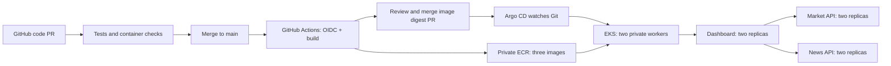

# EKS deployment runbook

Status (2026-10-21): deployed in Mumbai. Cluster `market-intel-prod` is active, with two Ready `t3a.medium` workers observed in ap-south-1a and ap-south-1b. Argo CD chart 10.10.5 is installed; application `market-intel` is Synced/Healthy, and dashboard, market-api and news-api each have 2/2 available replicas. Public ingress is disabled.

Initial release: [PR #1](https://github.com/Saisharath123/market_intel/pull/1), merge `606aef9`. [Image publishing](https://github.com/Saisharath123/market_intel/actions/runs/39543966875) and [release CI](https://github.com/Saisharath123/market_intel/actions/runs/39544349214) succeeded. These are point-in-time verification results, not continuous uptime guarantees.

## Start here: operate the deployed application

Use an authenticated AWS CLI session for the approved IAM principal, plus kubectl. Do not paste access keys into chat or commit them. The Kubernetes API allowlist must include your administrative egress address; the initial CloudShell address can change on restart.

```bash
aws eks update-kubeconfig --region ap-south-1 --name market-intel-prod
kubectl get nodes -L topology.kubernetes.io/zone
kubectl -n argocd get application market-intel
kubectl -n market-intel get deployments,pods
kubectl -n market-intel port-forward service/dashboard 8502:8501
```

Open http://localhost:8502 on the same machine running port-forward. Use a local authenticated terminal for browser access; a port-forward in CloudShell listens inside CloudShell, not on your laptop. The existing Streamlit Community Cloud URL remains a separate deployment.

Feed verification from the deployed dashboard: CNBC TV18 returned `ok`; Yahoo returned five of six current-session quotes around 10:02 IST, with TCS explicitly listed as missing. The dashboard health endpoint returned `ok`. A healthy deployment does not guarantee upstream data completeness or real-time exchange prices.

Initial ECR basic scans completed for all three images, each reporting 3 HIGH, 9 MEDIUM and 3 LOW OS-package findings. These findings have not been waived or remediated; assess fixed package availability and rebuild/release patched images before public production use. Basic scanning does not cover every Python dependency, and the release workflow currently does not enforce a vulnerability threshold.

For Argo CD, run `kubectl -n argocd port-forward service/argocd-server 8443:443` locally. Its initial administrator password is in Kubernetes secret `argocd-initial-admin-secret`; retrieve it privately in your own terminal and complete password rotation before sharing access. Do not export this secret into GitHub or application containers. Add organizational SSO before wider use.

For each code change, open a PR and inspect **Test and build**. After merge, **Build EKS release images** publishes immutable ECR images and creates a `release/images-<run-id>` branch. Current repository policy blocks bot-created PRs, so open that branch's PR using the workflow's comparison link, review and merge it. Argo CD then deploys automatically. Verify all deployments show 2/2 and the application shows Synced/Healthy. For rollback, revert the previous digest release in Git and merge the revert.



The approximate 730-hour baseline from the checked Mumbai rates is USD 150/month for the EKS control plane, two workers and one NAT gateway, before EBS, IPv4, logs, traffic and tax. No public load balancer was provisioned. This is an estimate, not a billing or free-tier guarantee.

## Intended resources

- Account `521595303406`, region `ap-south-1`, cluster `market-intel-prod`.
- EKS Kubernetes 1.36 (standard support); validate availability and eksctl support before creation.
- New VPC `10.80.0.0/16`, public and private subnets in two availability zones, one shared NAT gateway to limit recurring cost. This introduces an outbound-connectivity dependency on one zone and possible cross-zone transfer charges; it is not a fully zone-resilient egress design.
- Managed worker group: desired/minimum/maximum **2** `t3a.medium` Amazon Linux 2023 instances. Two nodes are the desired capacity, not a guarantee of one per zone or of physical availability. No cluster autoscaler is installed initially. Managed node updates may temporarily launch additional replacement capacity.
- Private workers, SSH disabled, private API connectivity plus a CIDR-restricted public administrative endpoint.
- ECR repositories: `market-intel/dashboard`, `market-intel/market`, `market-intel/news`.
- Dedicated GitHub OIDC image-publishing role, restricted to this repository's `main` branch and these ECR repositories; no cluster permissions.
- Argo CD installed inside EKS, UI initially accessed by port-forward, never exposed publicly by default.
- Two replicas of each application service, spread across nodes, with probes, resource bounds, disruption budgets and non-root containers.
- Optional public ALB ingress requires AWS Load Balancer Controller, its IAM role, a domain and an ACM certificate in ap-south-1. Without these, verify through port-forward.

EKS, nodes, EBS, NAT, logs and ALB are billable resources. Creating IAM/OIDC roles adds persistent access and requires a specific reviewed authorization at execution time under browser interaction rules.

## Before cluster creation

1. Confirm current identity with `aws sts get-caller-identity` and region. Read-only checks already confirmed no EKS cluster and no OIDC provider at the time of preparation.
2. Confirm permissions for CloudFormation, EKS, VPC/EC2, IAM role creation/pass-role and service-linked roles. Do not broaden the current user's permissions automatically.
3. Install current eksctl from its official release and verify its supported Kubernetes versions. Validate `infra/eks-cluster.yaml` using `eksctl create cluster --dry-run -f infra/eks-cluster.yaml`.
4. Replace documentation-only `203.0.113.10/32` with the operator's actual approved egress CIDR. CloudShell public egress can change when its environment restarts; use a stable admin egress or update the allowlist through AWS if needed. Never publish the API to the world as a workaround.
5. Check instance quotas/capacity and ensure the proposed VPC CIDR does not overlap connected networks.
6. After the exact IAM and networking changes are approved, run `eksctl create cluster -f infra/eks-cluster.yaml` and wait for completion. Verify `kubectl get nodes -o wide` shows two Ready nodes; inspect zone labels and pod distribution. Cluster creation takes time and can leave partially created stacks if interrupted.

## Bootstrap image publishing

1. Create the three private ECR repositories with immutable tags and scan-on-push; review scan results. Immutability means rerunning a release for the same SHA may require reusing the existing images rather than overwriting them.
2. Create/reuse GitHub's OIDC provider (audience `sts.amazonaws.com`). Create `market-intel-image-publisher` using `infra/github-image-trust.json`, attaching only `infra/github-image-permissions.json`. The observed repository subject includes immutable IDs: `repo:Saisharath123@168315578/market_intel@1427747568:ref:refs/heads/main`. Match the actual issuer claims exactly; do not widen trust with wildcards when a name-only subject fails. Review these account-specific policies before applying.
3. Set GitHub Actions repository variables: `AWS_REGION=ap-south-1`, `EKS_IMAGE_ROLE_ARN=<role ARN>`, `EKS_RELEASE_ENABLED=true`.
4. Ensure repository policy allows GitHub Actions to create pull requests. The release job creates a branch containing only image-digest updates. If bot-created PRs are not allowed, preserve the branch and open its PR manually. Never auto-merge as a workaround.
5. Run **Build EKS release images** on main. It tests the code, builds and pushes three images and proposes `deploy/chart/values-production.yaml`. Review the release PR and merge it. Until valid images are provided, Helm deliberately refuses to render deployment manifests.

## Bootstrap Argo CD and applications

1. Connect as the approved cluster administrator. Install a reviewed, pinned Argo CD Helm chart release into `argocd`; record chart and image versions. Configure authentication and restrictive RBAC before sharing its UI.
2. Create namespace `market-intel`, labelled with Pod Security Admission `enforce=restricted` and an appropriate Kubernetes version. Apply `deploy/argocd/project.yaml`, then `deploy/argocd/application.yaml` after the first approved image release.
3. The AppProject permits only this source repository and namespace-scoped app resources. The app uses no AWS credentials, Kubernetes service-account token or application secrets.
4. Argo CD watches main, deploys the approved image digests and self-heals drift. Pruning is disabled initially so removed resources require explicit review.
5. Verify deployments, endpoints, probes, news and quote timestamps. API liveness is intentionally independent of Yahoo or RSS outages; those are represented in API payloads instead of restarting healthy processes.
6. Preview with `kubectl -n market-intel port-forward service/dashboard 8502:8501`, then open localhost:8502. Verify the dashboard uses internal market/news APIs. Public ingress stays disabled until domain/certificate and controller are ready.

## Release and rollback

Code PR -> tests and container builds -> merge -> ECR image publishing -> release PR with three digests -> human review/merge -> Argo CD sync -> rollout health verification. Configure branch protection to require checks/review; it is not established merely by committing a workflow. GitHub-token-created PRs may not trigger new Actions runs; the release job already tests the application and CI on main validates merged chart changes. For stronger release-PR checks, use an explicitly approved GitHub App token.

Rollback by reverting the image-digest release commit in Git, reviewing and merging that revert; Argo CD then reconciles the previous images. Do not rely on a manual kubectl rollback while self-heal is enabled. Failed rollout progress keeps existing healthy replicas with maxUnavailable=0, but automated metrics-based promotion/rollback is not installed. Argo Rollouts, canary analysis and staging isolation are later increments.

## Operational limits and next requirements

- Streamlit browser sessions can reconnect or lose in-memory state during rollout or node failure. ALB stickiness helps routing but does not make session state durable.
- Market caches are per API replica. Yahoo may rate-limit or return delayed prices. There is no distributed cache, durable ingestion worker, database or automatic trading-calendar validation yet.
- This monorepo shares Python helpers, but services have separate images/processes, HTTP interfaces, dependencies, health checks and deployments. The dashboard retains standalone mode for the existing Streamlit site; EKS explicitly configures internal HTTP endpoints.
- Add alerting, dashboards, vulnerability policies, ingress TLS, backups, cluster upgrade procedures and tested recovery before calling the platform production-ready. Namespace RBAC and network isolation should be assessed before adding other workloads.
- Current IAM session cannot view billing. Billing permissions/credits have not been assumed. No credential values belong in Git, images or chat.
- Preserve the existing Streamlit site during migration. Postgres/pgvector and AI inference are separate future services and are not provisioned by this plan.

## Cleanup

Delete the app's ingress first and wait for ALB deletion; remove app resources and dedicated controllers as appropriate. Review and delete the eksctl-managed cluster/stacks only when explicitly authorized. Audit remaining NAT gateways, EIPs, EBS volumes, ECR images, log groups and IAM roles. Preserve shared account resources. Do not run destructive cleanup automatically on deployment failure.
